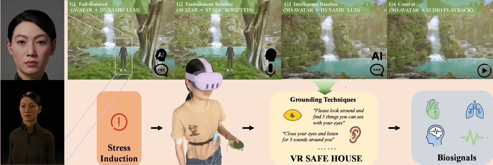

# REHUB VR Grounding

**A conversational digital human guides a five-stage grounding exercise in an immersive forest and waterfall environment.**

**Unreal Engine 5.7 · Windows PC VR / OpenXR · English / Chinese**

[Download the Windows demo](https://github.com/painfulmoments/Grounding_demo/releases/tag/v1.0.1) · [English setup guide](docs/PLAY_EN.md) · [中文主页](README.zh-CN.md) · [中文试玩说明](docs/PLAY_ZH.md)

*The teaser illustrates the wider research framework. This download offers the guided digital-human grounding experience, without all research-condition switches or biosignal acquisition.*

**Release status:** Windows build, desktop scene and launcher checks passed; a complete packaged Quest Link conversation remains **unverified**. [Validation record](docs/BUILD_AND_VALIDATION.md).

**Play requirements:** speech and AI dialogue use an **author-provided demonstration service**. No personal cloud account or API-key entry is required. Internet access and a compatible PC VR setup are required; this is not a standalone Quest app.

REHUB combines a structured exercise with spoken interaction, AI-assisted responses, a digital human with speech-driven facial animation, natural idle and speaking motion, and gentle gaze following. The experience moves through visual observation, sound awareness, cognitive grounding, guided breathing, and closing body awareness.

This public repository distributes a **playable build and documentation**. It does not include the complete Unreal Engine project or source code.

## Download and play

**Download BOTH ZIPs from the same Release and extract BOTH to the same destination. Neither ZIP is playable on its own.**

| File | Size / purpose |
| --- | --- |
| [Runtime ZIP](https://github.com/painfulmoments/Grounding_demo/releases/download/v1.0.1/REHUB-Windows-x64-v1.0.1-Runtime.zip) | About 306 MiB, required |
| [GameData ZIP](https://github.com/painfulmoments/Grounding_demo/releases/download/v1.0.1/REHUB-Windows-x64-v1.0.1-GameData.zip) | About 1.80 GiB, required |
| [Extract-REHUB.cmd](https://github.com/painfulmoments/Grounding_demo/releases/download/v1.0.1/Extract-REHUB.cmd) | Optional: verifies and extracts both ZIPs |
| [SHA256SUMS.txt](https://github.com/painfulmoments/Grounding_demo/releases/download/v1.0.1/SHA256SUMS.txt) | Optional: manual integrity verification |

1. Download both ZIPs, plus optional `Extract-REHUB.cmd` and `SHA256SUMS.txt`, from [Release Assets](https://github.com/painfulmoments/Grounding_demo/releases/tag/v1.0.1).
2. Recommended: put both ZIPs and the helper together and run `Extract-REHUB.cmd` to verify and extract. For manual extraction, extract both ZIPs to **one destination**, for example `C:\VR\`. Both contain the same top-level `REHUB-Windows-x64` folder, so their contents must merge into `C:\VR\REHUB-Windows-x64\`. **Do not accept Windows' default of a different extraction folder for each ZIP.**
3. Connect your Quest 3 to your Windows PC, open **Meta Horizon Link**, and enter **Link inside the headset**.
4. Double-click **`Launch-REHUB.exe`** inside the merged `REHUB-Windows-x64` folder. Select your dialogue language, microphone, and audio output, then launch the experience.
5. Start the experience and wait for the digital human's welcome message to finish.

Optional: download **`Extract-REHUB.cmd`** from the same Release, put it beside both ZIPs, and double-click it to extract them locally. The helper does not download or install software. These are **two independent ZIP archives**, not 7-Zip volumes; no 7-Zip installation is needed.

**Do not download GitHub's automatically generated “Source code (zip)” or “Source code (tar.gz)” to play.** Those archives contain this documentation repository, not the packaged game. You do not need Unreal Editor, Visual Studio, or Git to run the demo.

See the [English guide](docs/PLAY_EN.md) or [中文指南](docs/PLAY_ZH.md) for connection steps, prerequisites, and troubleshooting.

## Devices and requirements

The Windows Shipping build has been launched and its scene visually reviewed. A full packaged headset/cloud conversation playthrough remains pending; the device information below comes from development/editor testing.

| Item | Release information |
|---|---|
| Application | Windows x64 PC VR executable |
| Free disk space | Allow **8 GB** for downloads and extraction; a suggested margin, not a measured hardware minimum |
| Development-tested headset | Meta Quest 3 with Touch controllers |
| Development-tested connection | Wired Meta Horizon Link / Quest Link |
| Other headsets and Air Link | Not verified for this release |
| Standalone Quest / Android APK | Not included; the application runs on the PC |
| Speech input | A working Windows microphone, selected in the launcher |
| Speech and AI services | Internet access; the author provides the demonstration cloud service |
| Languages | Chinese and English, selected before launch |

Use a PC that meets the [Meta Horizon Link requirements](https://www.meta.com/help/quest/140991407990979/). Development testing used Windows 11 x64, an RTX 5070 Laptop GPU with 8 GB VRAM, and 32 GB RAM; **this is a tested configuration, not a measured minimum specification**. Performance depends on the PC and Link settings.

## Controls

| Input | Action |
|---|---|
| Left thumbstick | Move |
| Right thumbstick, left/right | Turn |
| Right controller **A** | Click once to begin recording; click again to submit |
| Close the desktop game window / **Alt+F4** | Exit |

**A is a toggle, not a hold-to-talk button.** Wait for the digital human to finish speaking, click A, say one answer, then click A again. Complete the requested observation or breathing step before reporting that you have finished it.

## Online demonstration service

Speech recognition, speech synthesis, and AI-assisted dialogue are provided through the author's demonstration cloud service. You can start after selecting your language and audio devices; you do not need to register separate cloud accounts or enter API keys.

Internet access is required. Service availability and usage capacity depend on the author's accounts, quotas, and upstream providers. Permanent access, unlimited usage, and a permanently free service are not promised.

Microphone recordings are submitted to Alibaba Cloud for recognition. The dialogue path can send recognized text and exercise context to DeepSeek, and assistant text is submitted to Alibaba Cloud for speech synthesis. Use the demo only if you are comfortable sending this information to these services.

The exercise combines local progression rules with AI-generated conversational replies. It is not an unrestricted chatbot, and not every spoken line is generated by an AI model.

## Help and feedback

- [Setup, microphone selection, and troubleshooting](docs/PLAY_EN.md)
- [中文安装与常见问题](docs/PLAY_ZH.md)
- [Report an issue](https://github.com/painfulmoments/Grounding_demo/issues): include your headset, connection method, Windows version, GPU, and steps to reproduce. Avoid including private personal information in attachments.

REHUB is a research and portfolio prototype and has not been clinically validated as a medical treatment.

## Validation

The [build and validation record](docs/BUILD_AND_VALIDATION.md) separates packaging, extraction, desktop launch, short cloud API checks and headset testing. v1.0.1 updates the documentation and packaging while retaining the v1.0.0 game binaries and data. No new full VR test was performed for this update.

## Use and acknowledgments

You may download and run the demo for personal, educational, or project-evaluation purposes. All other rights in the author-owned portions are reserved. Third-party assets and runtime components retain their respective ownership and terms; see [Third-party notices](docs/THIRD_PARTY_NOTICES.md). Public availability of the demo does not grant a source-code or asset-reuse license.

## Related project

[Lockdown：Breakout](https://github.com/painfulmoments/lockdown_breakout) is a Unity / OpenXR horror escape prototype with a two-floor environment.
