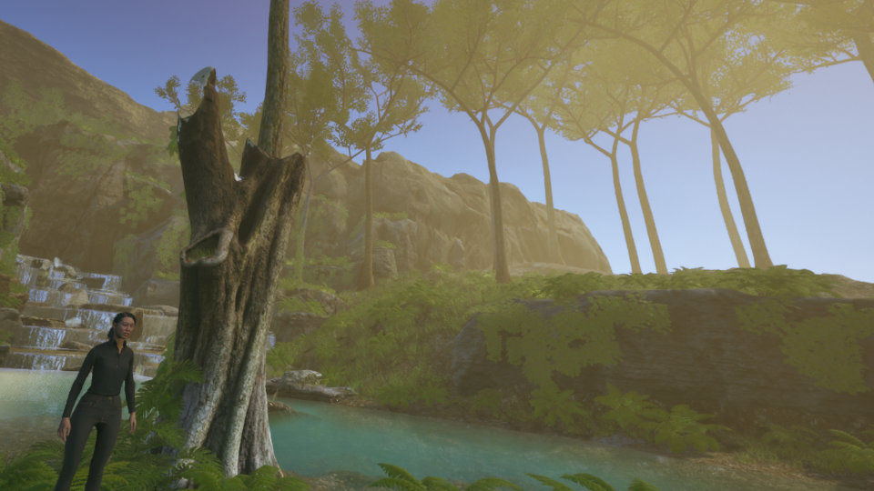

# REHUB VR Grounding

**在森林与瀑布场景中，与数字人通过语音完成五阶段着陆练习。**

[下载 Windows 试玩版](https://github.com/painfulmoments/REHUB-Demo/releases/latest) · [中文试玩说明](docs/PLAY_ZH.md) · [English](README.md)

**下载前请确认：** 完整语音与 AI 对话需要**自己的阿里云 NLS 和 DeepSeek 凭据**、网络连接，以及可运行 PC VR 的设备。这不是免凭据体验，也不是 Quest 独立应用。

REHUB 将视觉观察、声音觉察、认知着陆、呼吸调节和结束整合串成一段引导体验。数字人支持语音交互、AI 辅助回复、口型与面部动画、自然待机和说话动作，以及温和的注视跟随。

本公开仓库提供**可运行的试玩包和使用文档**，不包含完整 UE 工程与全部源码。

## 下载与启动

**两个 ZIP 都要下载，并解压到同一个目标目录。少一个就无法构成完整试玩程序。**

- [运行程序包：REHUB-Windows-x64-v1.0.0-Runtime.zip](https://github.com/painfulmoments/REHUB-Demo/releases/latest/download/REHUB-Windows-x64-v1.0.0-Runtime.zip)
- [游戏资源包：REHUB-Windows-x64-v1.0.0-GameData.zip](https://github.com/painfulmoments/REHUB-Demo/releases/latest/download/REHUB-Windows-x64-v1.0.0-GameData.zip)

1. 从同一个 [Release 的 Assets](https://github.com/painfulmoments/REHUB-Demo/releases/latest) 下载上面两个文件。
2. 将两个 ZIP 都解压到**同一个目标目录**，例如 `C:\VR\`。两个压缩包内部都有 `REHUB-Windows-x64` 顶层文件夹，解压后应合并为 `C:\VR\REHUB-Windows-x64\`。**不要接受 Windows 为每个 ZIP 分别创建不同解压文件夹的默认选项。**
3. 在电脑打开 **Meta Horizon Link**，连接 Quest 3，并在头显里进入 **Link**。
4. 在合并后的 `REHUB-Windows-x64` 文件夹里双击 **`Launch-REHUB.cmd`**，选择中文或英文、当前电脑的录音麦克风和声音输出设备，填写自己的云服务凭据。
5. 启动体验，等待数字人说完欢迎语，再开始回答。

也可从同一 Release 下载 **`Extract-REHUB.cmd`**，与两个 ZIP 放在一起双击，由它在本地完成解压。它不会下载或安装软件。这里是**两个独立 ZIP**，不是 7z 分卷，不需要安装 7-Zip。

**不要下载 Release 页面自动生成的 “Source code (zip)” 或 “Source code (tar.gz)” 来试玩。** 那是此文档仓库的归档，不是游戏程序。试玩无需安装 Unreal Editor、Visual Studio 或 Git，也不需要在编辑器中点击 VR Preview。

## 设备与依赖

下表设备信息来自开发阶段的编辑器现场测试；首次打包版本尚未完成完整的头显试玩验证。

| 项目 | 当前发布范围 |
|---|---|
| 程序 | Windows x64 PC VR 可执行程序 |
| 开发阶段实测头显 | Meta Quest 3 与 Touch 手柄 |
| 开发阶段实测连接 | 有线 Meta Horizon Link / Quest Link |
| 其他头显、Air Link | 本版本未验证 |
| Quest 独立运行 / Android APK | 不提供；程序运行在 Windows 电脑上 |
| 麦克风 | 电脑上实际可用的录音输入，在启动器中选择 |
| 云端语音与 AI | 需要联网及试玩者自己的阿里云 NLS、DeepSeek 凭据 |
| 对话语言 | 启动前选择中文或英文 |

电脑需满足 [Meta Horizon Link 的要求](https://www.meta.com/help/quest/140991407990979/)。开发实测设备为 Windows 11 x64、RTX 5070 Laptop GPU（8 GB 显存）、32 GB 内存；**这是实测配置，不是经过测定的最低配置**。

## 手柄操作

| 操作 | 功能 |
|---|---|
| 左摇杆 | 移动 |
| 右摇杆左右拨动 | 转向 |
| 右手柄 **A** | 按一次开始录音，再按一次结束并提交 |
| 关闭电脑上的游戏窗口 / **Alt+F4** | 退出 |

**A 不用按住。** 等数字人说完后开始录音，说完一句再提交；观察和呼吸动作应先完成，再回答已经完成。

## 云服务配置与隐私

当前试玩版使用**自备凭据**模式，不提供共享的公开 API Key 或免费托管的 AI 服务。启动器需要阿里云 AccessKey ID、AccessKey Secret、NLS 项目 AppKey，以及 DeepSeek API Key；使用独立英文识别项目时，可另填英文识别 AppKey。

录音会提交给阿里云进行语音识别；对话路径可能将识别文字和练习上下文发送给 DeepSeek，回复文本会提交给阿里云合成语音。服务费用由试玩者自己的云账户承担。凭据只在本机配置，不要放进公开 Issue 或截图。

这套体验结合本地流程规则和 AI 对话回复，不是无限制聊天机器人，也不是每一句引导语都由 AI 即时生成。

详细设置与常见问题请看 **[中文试玩说明](docs/PLAY_ZH.md)**。反馈问题时请提供头显、连接方式、Windows 版本、显卡和复现步骤，并移除附件中的凭据。

REHUB 是研究与作品展示原型，尚未经过作为医疗治疗手段的临床验证。

## 使用范围与致谢

允许下载并运行此试玩版，用于个人体验、教学或项目评估。作者自有内容的其他权利保留；第三方资产与运行时组件仍适用原权利人的条款，详见 [第三方说明](docs/THIRD_PARTY_NOTICES.md)。公开下载不代表开放全部源码或授权提取、复用其中的资产。
